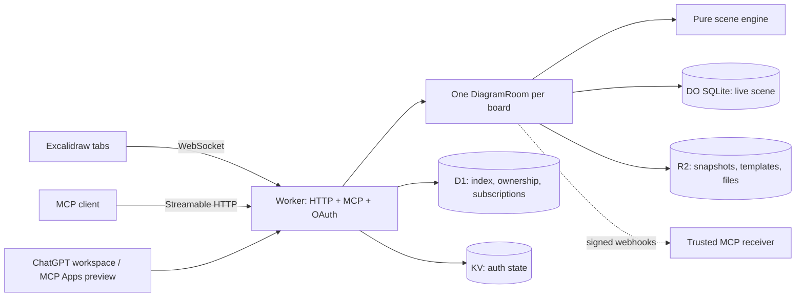

# Design and trust boundaries

For setup commands, see [setup.md](setup.md). For the ChatGPT host adapter, see
[chatgpt-plugin-api.md](chatgpt-plugin-api.md).

## Architecture

HTTP and MCP delegate mutations to `DiagramRoom`; the room owns persistence,
broadcasts, versions and browser RPC. The pure scene engine has no I/O. Keeping
these responsibilities together lets human and agent edits share recovery rules.
MCP is stateless: every board tool receives the share link rather than retaining an
agent's active board on the server.

The OAuth provider is loaded only for its protocol paths, so ordinary canvas traffic
avoids that dependency. Static assets must send API, socket, OAuth and verification
paths to the Worker before the SPA fallback; see `src/worker/oauth-paths.ts`.

## Edits and sync

Human updates use Excalidraw's version merge: higher version wins, then lower
`versionNonce`. Accepted changes persist in a SQLite transaction before broadcasting;
tabs reconcile them with Excalidraw. Deletions travel as tombstones. Expired tombstones
are collected only with no connected tabs; a tab offline beyond the retention window
can miss a deletion. Presence lives on WebSocket attachments to survive hibernation.

Agent operations work on cloned elements and commit before broadcasting. Batches
return per-operation results and may partially succeed; callers must inspect those
results. An automatic snapshot precedes agent patches, Mermaid imports and explicit
layout. Tidy snapshots only when it finds a change. Labels can identify nodes only
when unique; stable IDs avoid ambiguity.

Tidy preserves design intent: it wraps notes, resolves spacing/overlaps and routes
connections without changing labels, colours or connectivity. Edited blocks yield
more readily than existing artwork. Full dagre layout is opt-in because it can
rearrange the design. Icons move as groups, including their artwork and caption.

Screenshots, Mermaid conversion and focus/point run in the most recently focused
canvas tab. With no tab, the room briefly waits for reconnect, then asks the user
to open the share link. Reopen/focus the intended tab after a timeout; broadcasting
these requests to every tab could return another collaborator's selection or view.
Focus/point changes the viewport or marker without creating a scene version.

## Access and privacy

The share link is a capability for reading and editing a board, including files,
versions and WebSockets. OAuth authenticates MCP callers; it does not replace the
board capability. All MCP calls require `mcp:read`; write tools also challenge for
`mcp:write`. Browser creation and private-library access use GitHub sessions. Both
auth paths encode the same GitHub subject for ownership.

Libraries and saved templates are owner-scoped. Saving a template requires ownership
of its source board. Shared-link collaborators can draw without signing in, but
permanent deletion requires the signed-in owner and a same-origin request. Treat
URLs as credentials; snapshots provide recovery, not access control. Links have no
read-only tier or rotation workflow.

Legacy boards remain reachable by their original links and stay out of private
libraries until an operator explicitly assigns ownership in `diagram_owners`.
Signing in must never claim an old board automatically.

The Excalidraw element wire format preserves opaque extension fields while validating
core fields. Those extensions are compatibility data, not a validation guarantee for
arbitrary downstream use; see `src/shared/protocol.ts` and `src/shared/schemas.ts`.

## Recovery and erasure

D1 metadata and R2 objects are separate writes. Snapshots write R2 before D1; a crash
between them can orphan an object. Restore validates the stored scene, takes a safety
snapshot, then applies it, returning `undoSnapshotId`. There is no automatic snapshot
retention, and the current listing exposes only the latest 30 by default. A displayed
version list is not the complete retained history.

Owner deletion records a marker and closes sockets before erasing files, snapshots,
subscriptions, library metadata and room contents. The ownership record and deletion
marker remain so an interrupted cleanup can be retried through the owner-authenticated
`DELETE /api/diagrams/:id` route. Independent template copies survive source deletion.
Use the application's owner route for retries so the revocation and erasure order is
preserved.

`ensureSchema` creates D1 tables on first use; there is no separate initial migration
command. The schema's authoritative definition is `src/worker/store.ts`.

## MCP events

Subscriptions are scoped to the capability and original OAuth consent grant. Delivery
rechecks the grant, capability hash, expiry and cancellation before each attempt.
A different installation cannot unsubscribe or rotate another installation's secret.
Agent changes are withheld unless `include_agent` is set, preventing feedback loops.
Payloads carry event metadata/counts, not scene elements or share keys; receivers
re-read the board with `get_scene` for detail.

Delivery runs outside the edit's critical path. Retries can duplicate an event and a
restart can drop it; there is no event log or replay (`cursor: null`). Consumers needing
certainty must re-read state. Unsubscribe, deletion and grant revocation stop future
delivery once visible; grant checks inherit KV consistency limits.

Receiver hostnames must be explicitly trusted. The implementation checks public A/AAAA
answers before each POST, requires HTTPS, refuses redirects and signs serialized bytes.
Workers fetch cannot pin the validated address while preserving hostname TLS checks,
so DNS preflight alone does not eliminate rebinding. Arbitrary user-controlled callback
hosts need an egress service with address pinning, not a broader allowlist.
See [event configuration](setup.md#mcp-events) for setup and live verification.

## Diagram library API

`GET /api/diagrams?limit=50&cursor=...` requires a browser session and returns
`{ items, nextCursor }`. The maximum page size is 100. Pass the cursor unchanged;
null marks the last page. Ordering is by creation time and ID, so newer inserts do
not shift later pages. Libraries omit templates, deleted boards and unowned legacy
boards. Saved templates are listed separately and remain private to their owner.

See [MCP result compatibility](structured-content.md) for the reason tool results
carry both text and structured data. Tool/prompt schemas in `src/worker/mcp.ts` and
the shared wire types are the authoritative API definitions.
